<div align="center">

<picture>
  <source media="(prefers-color-scheme: dark)" srcset="assets/banner-dark.svg" />
  <source media="(prefers-color-scheme: light)" srcset="assets/banner-light.svg" />
  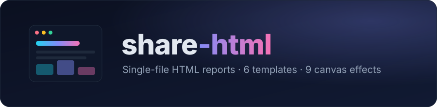
</picture>

**Self-contained HTML templates for shareable reports — double-click to open, drag to share.**

A [Claude Code](https://docs.anthropic.com/en/docs/claude-code) skill that generates single-file `.html`
reports with **interactive components**, **data visualization**, and optional **canvas effects**.
No build step, no server.

[](https://docs.anthropic.com/en/docs/claude-code)
[](#-templates)
[](#-canvas-effects)
[](#-tech-stack)
[](LICENSE)

[Install](#-install) · [Features](#-features) · [Templates](#-templates) · [Canvas Effects](#-canvas-effects) · [Usage](#-usage) · [Tech Stack](#-tech-stack) · [License](#-license)

</div>

---

<div align="center">
  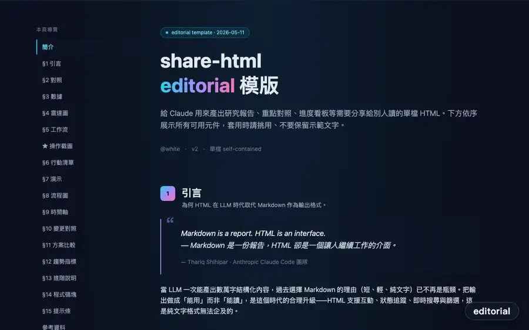
</div>

## 📦 Install

```bash
npx skills add ggwhite/share-html
```

## ✨ Features

<table>
<tr>
<td width="42%" valign="middle">

### editorial — the default report

A deep dark theme with a **sticky TOC** that tracks your scroll, gradient accents, and
**18 interactive components**. Filter a **searchable findings table**, drag **Kanban**
cards, read **Chart.js radar charts**, and tick off a **checklist with a progress bar**.
Best for research reports, code reviews, and comparative analysis.

</td>
<td>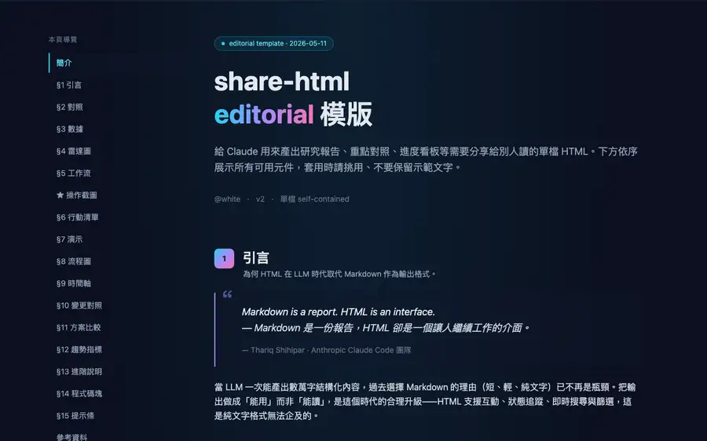</td>
</tr>
<tr>
<td width="42%" valign="middle">

### briefing — one idea per screen

Full-page **slides** with warm amber tones. Each section fills the viewport with large
text and **animated stat counters**, glued together with **scroll snap** and bottom dot
navigation. Built for weekly reports and executive summaries.

</td>
<td></td>
</tr>
<tr>
<td width="42%" valign="middle">

### dashboard — dense, tabbed data

Three **tab panels** — overview, detail, and trends — packed with metrics, sparklines,
radar charts, and tables in **2–3 column grids**. Charts initialize **lazily** the first
time their tab opens.

</td>
<td>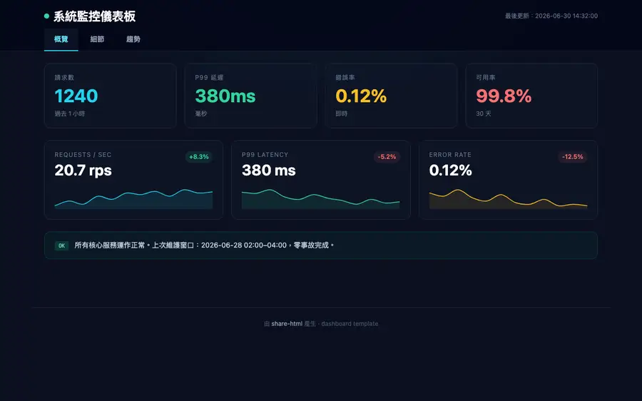</td>
</tr>
<tr>
<td width="42%" valign="middle">

### docs & minimal — light and lean

**docs** is a clean white theme for technical documentation, with the same two-column
TOC layout as editorial and **GitHub-style code highlighting**. **minimal** drops the
TOC and progress bar entirely: one centered `max-w-2xl` column for sharing **one
conclusion fast**.

</td>
<td>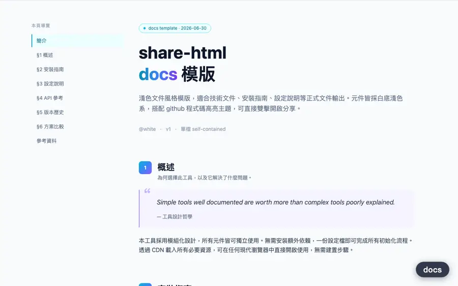</td>
</tr>
<tr>
<td width="42%" valign="middle">

### handdrawn — notebook & whiteboard

For meeting notes, decision records, and workshop summaries. **Rough.js** draws sketchy
borders, marker underlines, and **sticky notes**; **JasonHandwriting** sets Traditional
Chinese headings and labels while long paragraphs stay in readable system fonts.

</td>
<td>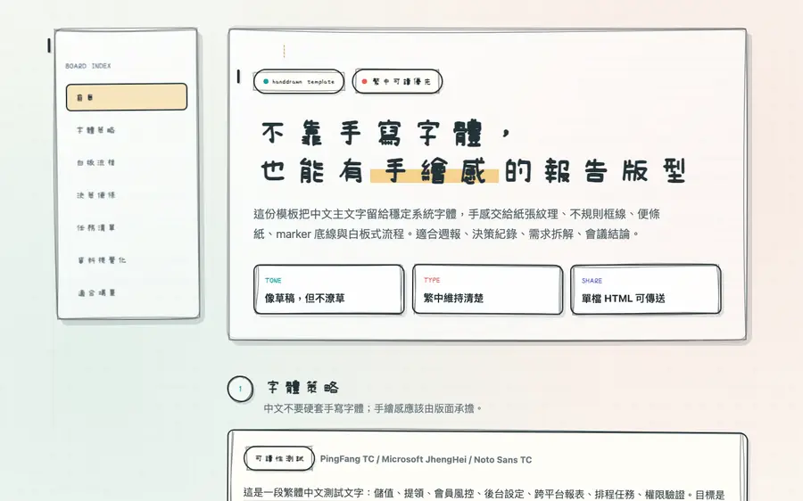</td>
</tr>
<tr>
<td width="42%" valign="middle">

### Nine canvas effects

Drop an optional background effect into any template — from **light** CSS glows to
**heavy** Perlin-noise flow fields. All of them respect **`prefers-reduced-motion`**
and pause when the tab is hidden.

</td>
<td>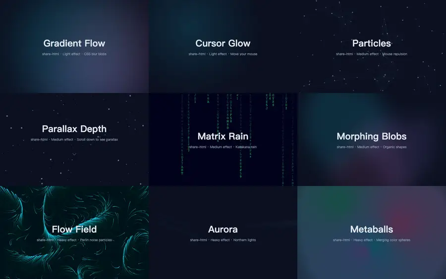</td>
</tr>
</table>

## 🖼 Templates

Six templates. Claude picks the one that fits your content, or you can name one directly.
Click a thumbnail for the full-size screenshot.

<table>
<tr>
<td align="center" width="33%"><a href="screenshots/editorial.png">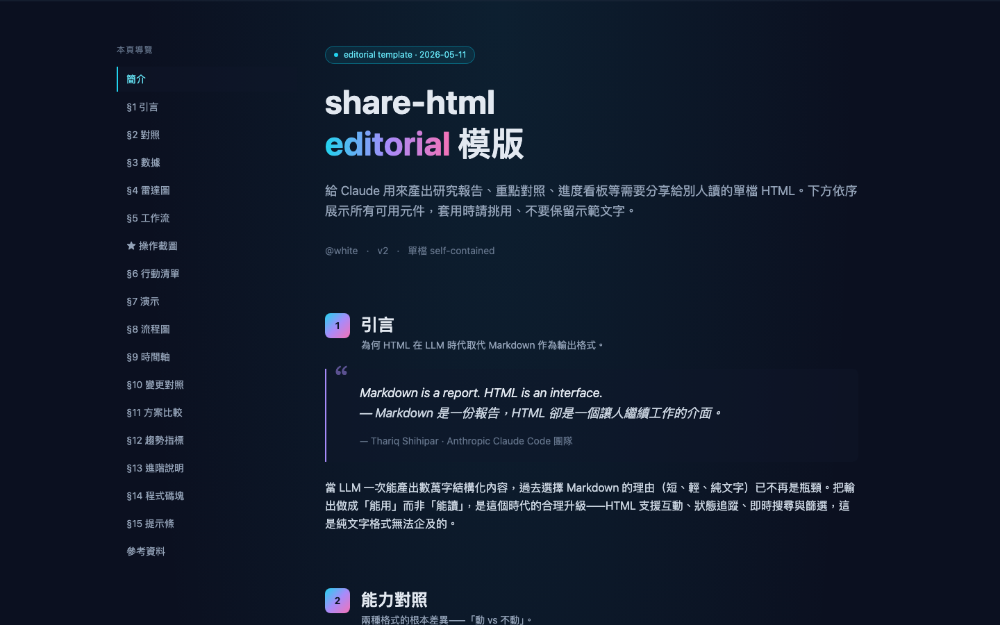</a><br/><b>editorial</b> (default)<br/><sub>research reports · code reviews</sub></td>
<td align="center" width="33%"><a href="screenshots/briefing.png"></a><br/><b>briefing</b><br/><sub>weekly reports · exec summaries</sub></td>
<td align="center" width="33%"><a href="screenshots/dashboard.png">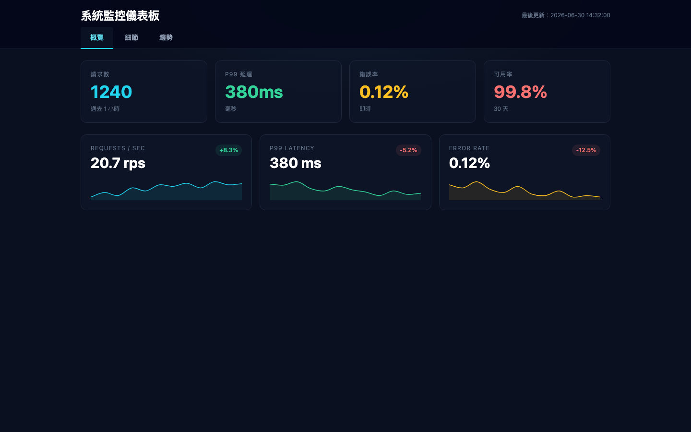</a><br/><b>dashboard</b><br/><sub>metrics · monitoring</sub></td>
</tr>
<tr>
<td align="center" width="33%"><a href="screenshots/docs.png">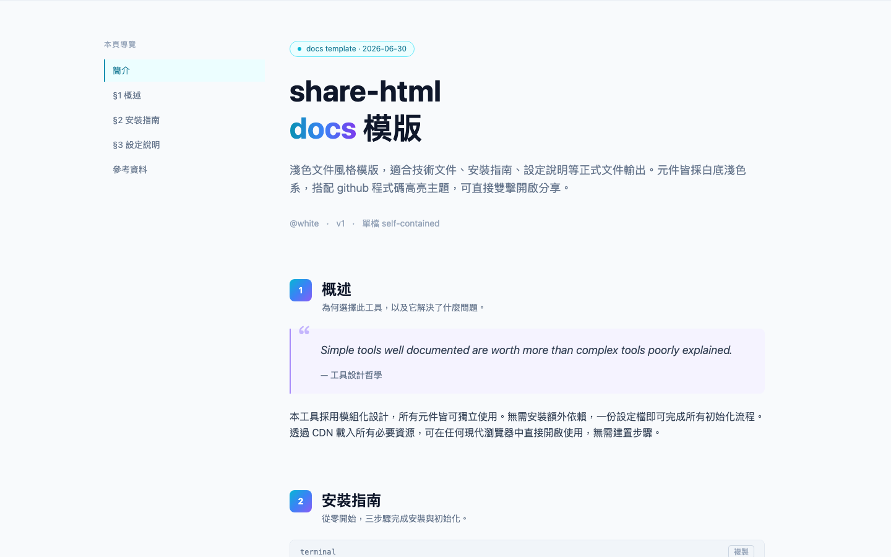</a><br/><b>docs</b><br/><sub>technical documentation</sub></td>
<td align="center" width="33%"><a href="screenshots/minimal.png">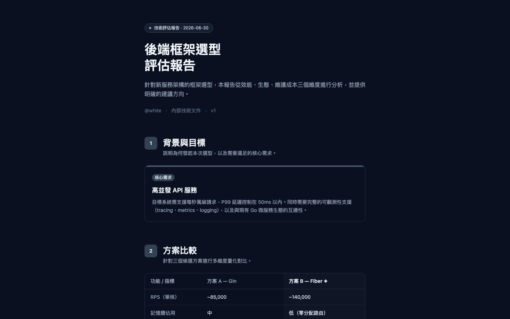</a><br/><b>minimal</b><br/><sub>one conclusion, fast</sub></td>
<td align="center" width="33%"><a href="screenshots/handdrawn.png">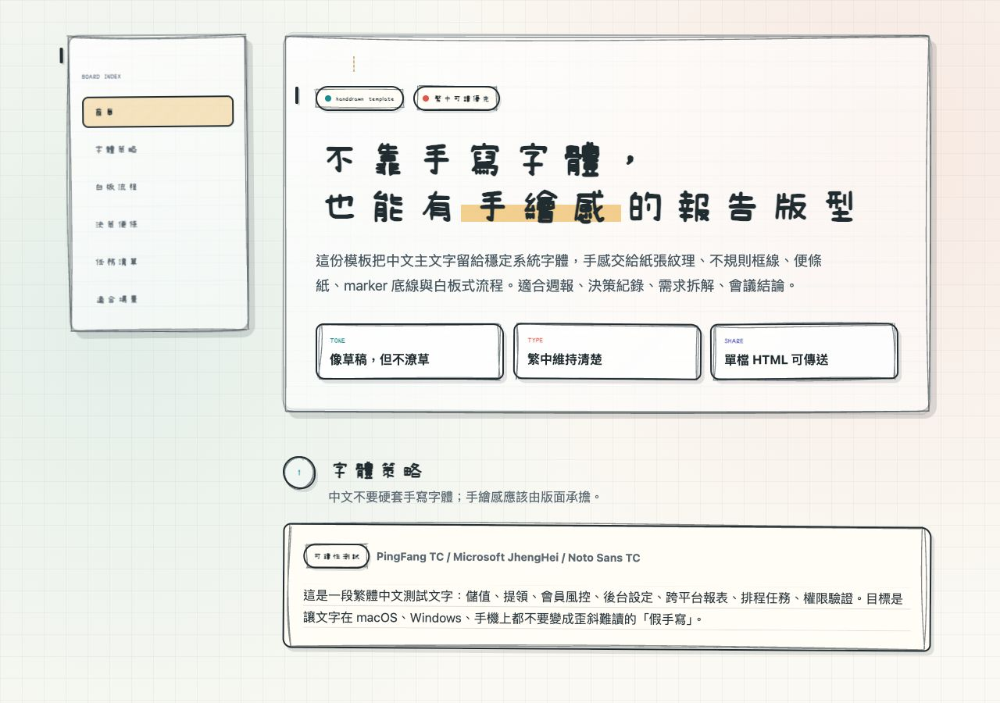</a><br/><b>handdrawn</b><br/><sub>meeting notes · decisions</sub></td>
</tr>
</table>

| Template | File | Highlights |
|----------|------|------------|
| editorial (default) | `template.html` | Sticky TOC with scroll tracking, searchable tables, drag-and-drop Kanban, radar charts & sparklines, checklists |
| briefing | `template-briefing.html` | One section per screen with scroll snap, dot navigation, animated counters, amber/orange/rose accents |
| dashboard | `template-dashboard.html` | Tab switching with lazy chart init, dense 2–3 column grids, real-time-style timestamp |
| docs | `template-docs.html` | Light background (`#f8fafc`), GitHub code highlighting, collapsible FAQ, cyan/blue/violet accents |
| minimal | `template-minimal.html` | `max-w-2xl` centered column, no gradients, muted slate palette, minimal JavaScript |
| handdrawn | `template-handdrawn.html` | Handwriting headings & labels, Rough.js sketch borders, sticky notes, whiteboard flow blocks |

## 🌌 Canvas Effects

Nine optional visual effects you can drop into any template. Add them to `<body>` before your content.

| Effect | File | Weight | Description |
|--------|------|--------|-------------|
| gradient-flow | `effects/gradient-flow.html` | Light | Drifting color blobs with CSS blur |
| cursor-glow | `effects/cursor-glow.html` | Light | Mouse-following radial glow |
| particles | `effects/particles.html` | Medium | Floating particles with connecting lines |
| parallax-depth | `effects/parallax-depth.html` | Medium | Three-layer scroll parallax |
| matrix-rain | `effects/matrix-rain.html` | Medium | Katakana/number rain effect |
| morphing-blobs | `effects/morphing-blobs.html` | Medium | Organic shape-shifting blobs |
| flow-field | `effects/flow-field.html` | Heavy | Perlin noise particle flow |
| aurora | `effects/aurora.html` | Heavy | Northern lights wave bands |
| metaballs | `effects/metaballs.html` | Heavy | Merging color spheres |

All effects respect `prefers-reduced-motion` and pause when the tab is hidden.
Every dark template works with all of them; the light docs template only suits cursor-glow.

## 🚀 Usage

Once installed, trigger the skill in Claude Code with:

- 「做 HTML 給別人看」
- 「產一份報告」
- 「套我的 template」
- 「用 share-html」

Claude will pick the best template based on your content, or you can specify one directly.

## 🧰 Tech Stack

- [Tailwind CSS](https://tailwindcss.com/) (CDN)
- [Alpine.js](https://alpinejs.dev/) (CDN)
- [Chart.js](https://www.chartjs.org/) (CDN, only when needed)
- [highlight.js](https://highlightjs.org/) (CDN, only when needed)
- Canvas 2D API (effects only)

Zero build step. Zero dependencies. Every output is a single `.html` file.

<details>
<summary>Regenerating the README clips</summary>

The animated WebP clips in `assets/` are recorded from the real templates with Playwright:

```bash
pip install playwright && playwright install chromium   # once
brew install ffmpeg webp                                 # ffmpeg + img2webp
python3 scripts/record-clips.py                          # all clips
python3 scripts/record-clips.py tour effects             # just some
```

</details>

## 📄 License

[MIT](LICENSE)
